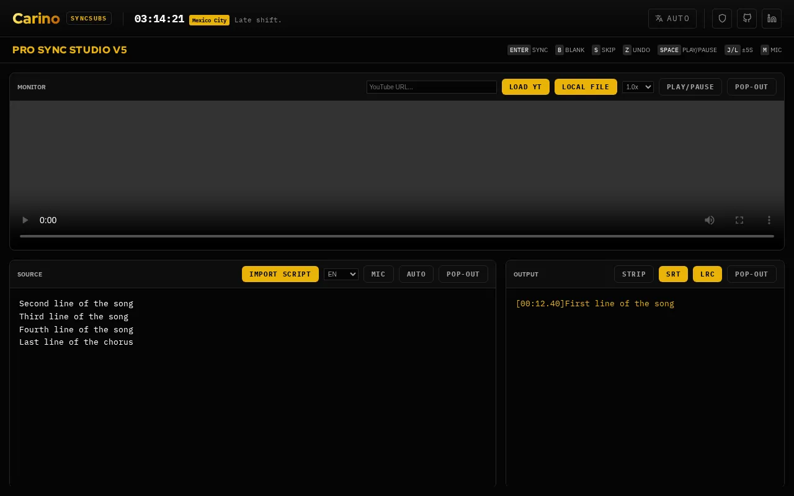

# SyncSubsStudio

Time subtitles or song lyrics by hand: play the video or song, press Enter as each line is said or sung, and export an .lrc or .srt file.

**[Open it →](https://subs.carino.systems/)** — runs in your browser, nothing to install, no account.

## What it does

- Plays a local video or audio file, or a YouTube link, at 0.5x to 2x speed.
- Paste a script, or import an existing .srt, .lrc or .ass file: its timings are stripped so you can re-time the lines.
- Keyboard-driven: Enter stamps the next line at the current time, B adds an empty stamp, S skips a line, Z undoes, Space plays and pauses, J and L jump 5 seconds.
- Press M to transcribe from the microphone instead of a script, in 11 languages. Chrome and Edge use the browser's own speech recognition; other browsers such as Firefox run the Whisper model inside the page.
- Exports LRC or SRT. In SRT, each line ends just before the next one starts.
- Pop the video, source or output panel out into its own window, for example onto a second screen.

Your media files and text are not uploaded. The source and output are saved to this browser's local storage every 5 seconds. The page does go online in two places: it loads YouTube's player API when it opens, and the first time the Whisper path is used it downloads a speech model of about 39 MB from Hugging Face, which the browser then caches.

## Licensing

**Mine — GNU Affero General Public License v3.0 or later.** Everything in this
repository *except* the paths listed below. Copyright © 2026 Miguel Carino.
Full terms in [LICENSE](LICENSE).

**Not mine.** The files below are third-party works redistributed here. This
project's licence does not cover them and could not: they are not mine to
relicense. Each keeps its own terms, and each carries its own notice.

| Path | What it is | Licence | Notice |
| --- | --- | --- | --- |
| [`fonts/`](fonts/) | IBM Plex Mono, IBM Plex Sans, Red Hat Display | SIL OFL 1.1 | [`fonts/OFL.txt`](fonts/OFL.txt) |
| [`vendor/`](vendor/) | third-party JavaScript | per package — see the notice | [`vendor/README.md`](vendor/README.md) |

Those files travel with any fork, mirror or repackaging of this repository, and
their notices must travel with them.
